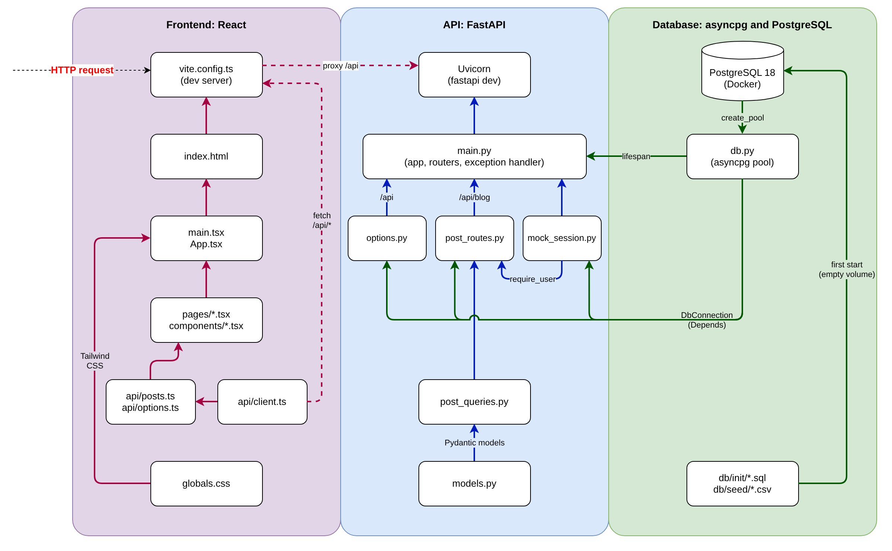
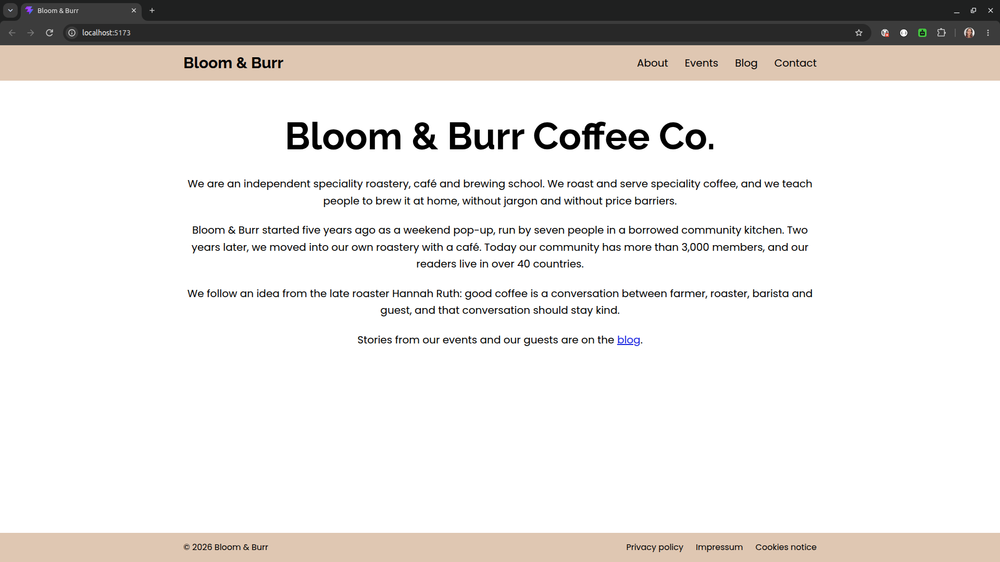
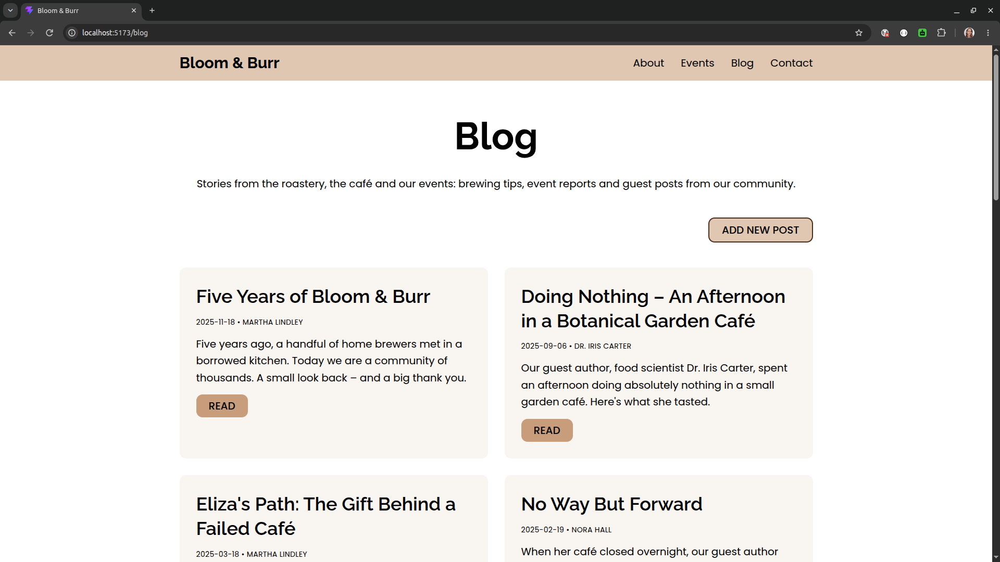
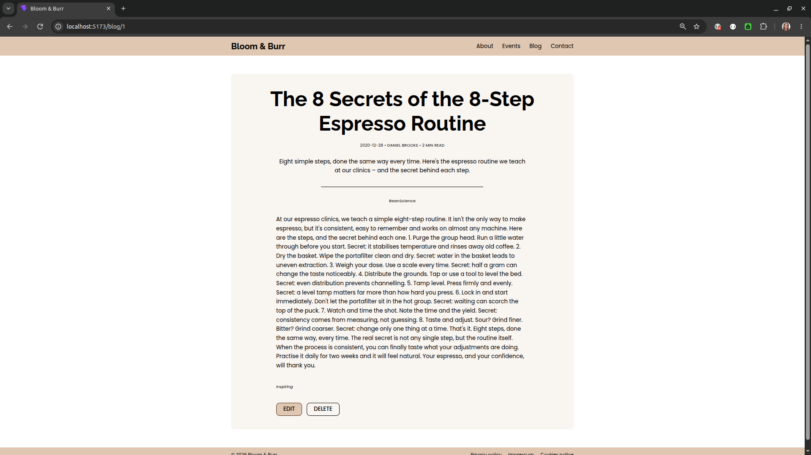
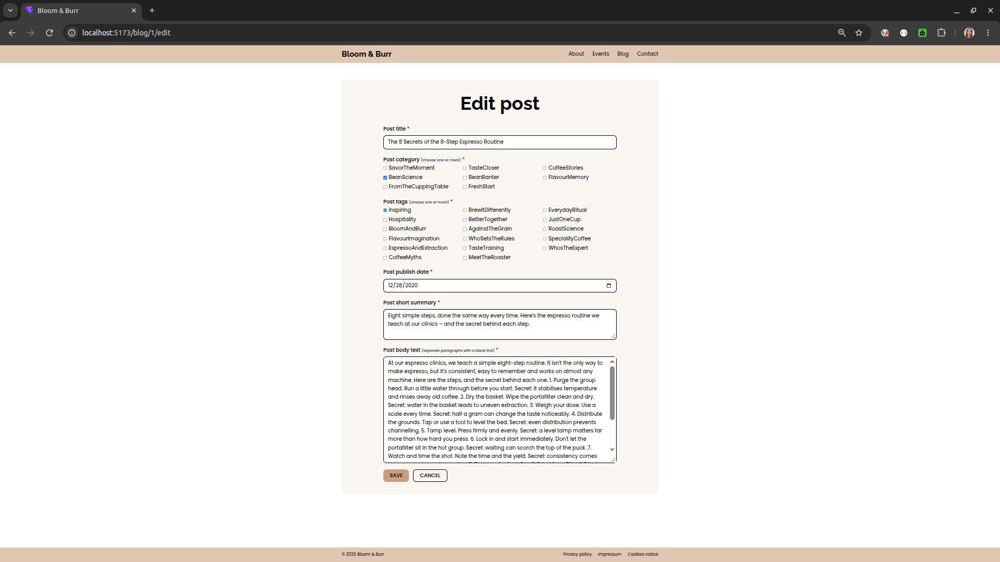
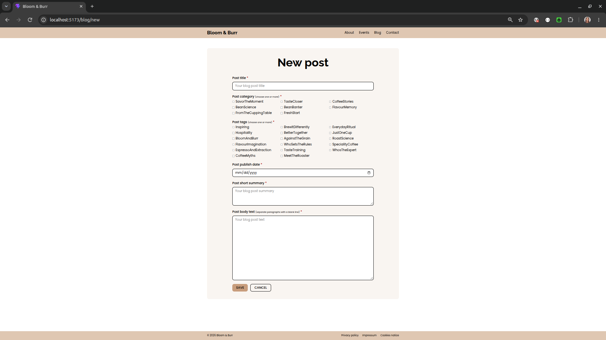

# Content hub: a JSON REST API with FastAPI and PostgreSQL

A learning project to practise **FastAPI**, **Python**, **PostgreSQL** and REST API design by building a small JSON REST API for blog posts. The posts are stored in PostgreSQL, which runs in a Docker container. The second part practises **Docker**, **Terraform** and **GCP**: the app is packaged as one image and deployed to Cloud Run with Cloud SQL.

> The API rebuilds the Express API of [content-hub-react-express-postgresql](https://github.com/beatanemeth/content-hub-react-express-postgresql) in FastAPI. The **React** frontend comes from the same repository, and its pages are adapted to the FastAPI API step by step.

> The full build log, step by step, is in [NOTES.md](NOTES.md) for the local app and in [NOTES_DEPLOYMENT.md](NOTES_DEPLOYMENT.md) for the deployment. The deployment's commands are in the [runbook](docs/runbook.md); the output and screenshots of the real run are in [docs/real-run/](docs/real-run/).

> The app has no sign-in or sign-up and only the blog post endpoints. The workaround for the missing parts, and the reasons for it, are in [info_out_of_scope_workaround.md](docs/notes/info_out_of_scope_workaround.md).

> **Authorship note:** Planned by me, implemented with Claude Code. Content by me, wording by Claude.

<br>

## Evolution roadmap

Each version is built in phases: see the [backend roadmap](docs/claude/evolution_roadmap_backend.md), the [frontend roadmap](docs/claude/evolution_roadmap_frontend.md) and the [deployment roadmap](docs/claude/evolution_roadmap_deployment.md).

- **v0.1.0:** API endpoint development with in-memory storage, tested through the REST Client extension in VS Code (`blog.http`). [Release notes](https://github.com/beatanemeth/content-hub-react-fastapi-postgresql/releases/tag/v0.1.0) · [Browse the code](https://github.com/beatanemeth/content-hub-react-fastapi-postgresql/tree/c13d1f0c6943809d6644e7aebc273bda206ad5d2)
- **v0.2.0:** PostgreSQL integration. [Release notes](https://github.com/beatanemeth/content-hub-react-fastapi-postgresql/releases/tag/v0.2.0) · [Browse the code](https://github.com/beatanemeth/content-hub-react-fastapi-postgresql/tree/1e07b1b624718c46d5be3f9d1f5b5ddd1807e69c)
- **v0.3.0:** simple frontend with React. [Release notes](https://github.com/beatanemeth/content-hub-react-fastapi-postgresql/releases/tag/v0.3.0) · [Browse the code](https://github.com/beatanemeth/content-hub-react-fastapi-postgresql/tree/b2ec57f377809d685010bb893fd08494dabf642f)
- **v0.4.0:** Terraform deployment to GCP. [Release notes](https://github.com/beatanemeth/content-hub-react-fastapi-postgresql/releases/tag/v0.4.0) · Browse the code on the `main` branch

To run an older version with `blog.http`, see [Keep blog.http working in every version](NOTES_DEPLOYMENT.md#16-keep-bloghttp-working-in-every-version).

<br>

## Architecture



Solid arrows point from a file to the file that uses it. Dashed arrows show the path of an HTTP request.

<br>

## Technical details

| Item             | Version         |
| ---------------- | --------------- |
| Operating system | Linux Mint 21.2 |
| uv               | 0.13.7          |
| Python           | 3.14.10         |
| FastAPI          | 0.163.1         |
| PostgreSQL       | 18              |
| asyncpg          | 0.32.0          |
| Ruff             | 0.17.5          |
| Pyright          | 1.1.414         |
| Node.js          | 24.14.0         |
| React            | 19.3.1          |
| React Router     | 8.5.1           |
| Vite             | 8.3.8           |
| Tailwind CSS     | 4.3.5           |

<br>

## Run the API

In the project root:

```bash
cp .env.example .env             # then set real values in .env
docker compose up -d db          # starts PostgreSQL and loads the seed data
```

In `backend/`:

```bash
uv sync                          # installs the dependencies into backend/.venv/
uv run fastapi dev app/main.py   # starts the server on port 8000
```

- **Swagger UI:** `http://localhost:8000/docs`
- **Requests:** `blog.http` holds a request for each endpoint; run it from top to bottom with the VS Code REST Client extension.
- **Reset the data:** the posts stay in the `pgdata` volume across restarts. `docker compose down -v`, then `docker compose up -d db`, starts again from the seed data.

<br>

## Run the frontend

In `frontend/`, with the API running:

```bash
npm install   # installs the dependencies into node_modules/
npm run dev   # starts the Vite dev server on port 5173
```

- **App:** `http://localhost:5173`
- **Node.js version:** Volta reads `volta.node` in `package.json` and switches to Node.js 24.14.0 inside `frontend/`.
- **API calls:** the Vite dev server forwards every `/api` request to `http://localhost:8000`.

<br>

## Run the app as one container

The image that Cloud Run runs also runs locally. FastAPI serves both the API and the built React app, so one address is enough. In the project root, with `.env` set as above:

```bash
docker compose up --build        # builds the image, then starts PostgreSQL and the app
```

- **App and Swagger UI:** `http://localhost:8080` and `http://localhost:8080/docs`. The login works as below, with port `8080` instead of `8000` and `5173`.
- **Stop:** Ctrl+C, then `docker compose down`.

<br>

## Log in to write posts

Reading is public. Adding, editing and deleting a post need a mock session cookie in the browser; without it, the app shows `Not signed in`. The app has no login page, so the login runs in the Swagger UI:

1. In the same browser as the app, open `http://localhost:8000/docs`.
2. In the **session** group, open **POST /api/mock-login** and click **Try it out**.
3. Set the request body to `{ "person_id": 1 }` and click **Execute**. The answer is `200` with `{"id": 1, "full_name": "Martha Lindley"}`.
4. Go back to `http://localhost:5173/blog`. Add, edit and delete now work.

- **`localhost`, not `127.0.0.1`:** a cookie belongs to a host name, and the port does not matter. A login at `127.0.0.1:8000` saves the cookie for `127.0.0.1`, so the app at `localhost:5173` does not send it.
- **Not with `blog.http`:** the REST Client extension keeps its own cookies inside VS Code, so a login there does not reach the browser.
- **Staff members:** `person_id` 1 to 4 are staff in the seed data. The logged-in person becomes the author of a new post. Any other id gives `401 Unknown staff member`.
- **Logged out after a restart:** the sessions live in the server's memory. `fastapi dev` restarts the server on every saved backend file, so log in again after a change. `uv run fastapi run app/main.py` starts the server without auto-reload.
- **Log out:** run **POST /api/mock-logout** in the same way (`204`).

<br>

## Page snapshots





_Note: the next three images were taken at different zoom levels, so that each page fits on one screen._






